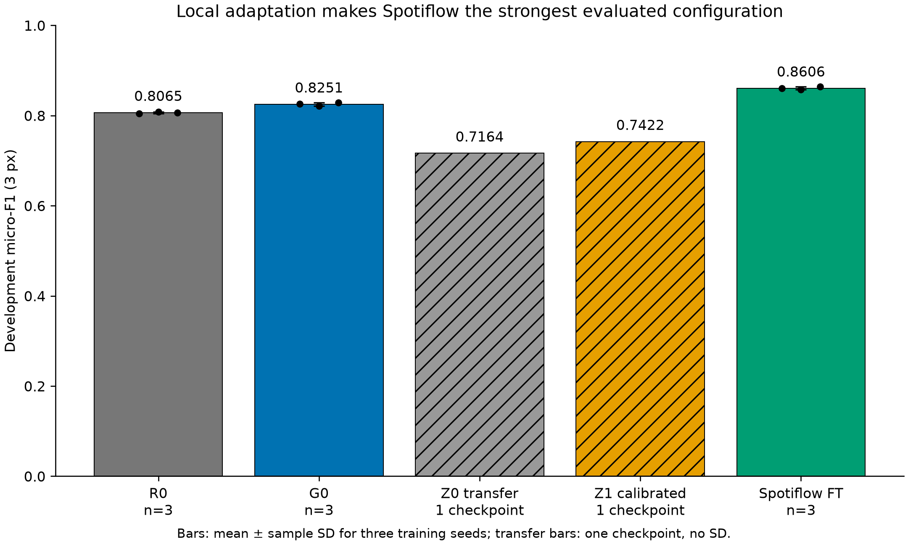
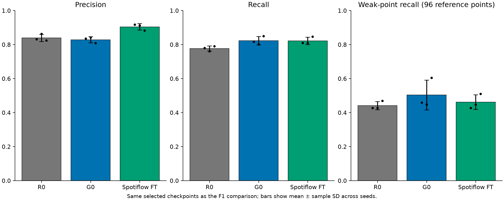
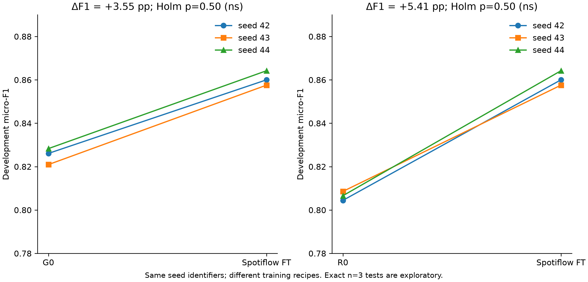
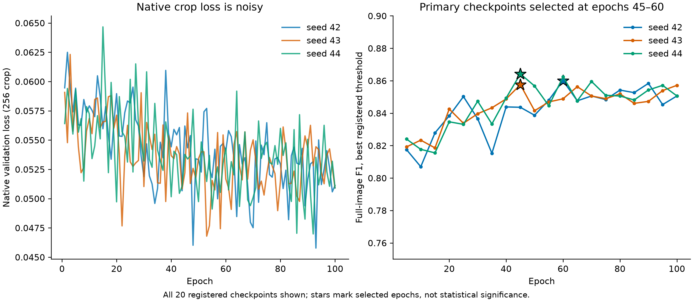

# Spotiflow CUDA三种子结果与模型比较报告

报告日期：2026-10-30，America/New_York。服务器文件名/终端中的10月31日按服务器时区记录，不据此改写用户日期。

## 核心结论

Spotiflow general权重经过本地数据适配后，三种子开发验证micro-F1为 **0.8606 ± 0.0034**，高于G0的 **0.8251 ± 0.0038**，平均差 **+3.55个百分点**，三个种子方向一致。当前应将适配后的Spotiflow记为已评估配置中开发micro-F1最高的方法，G0保留为自有方法中的简单候选。不能继续用G0优于未经适配Z0/Z1的结果说明自有方法优于Spotiflow。

这也意味着：**目前没有证据支持“我们的核心架构最好”**。比较包含预训练、表示、损失、增强和训练预算差异；验证集同时参与选模与校准，尚无新增独立测试证据。

## 数据与工程验收

- 176张训练图、22张验证图；验证参考372点。两种原始尺寸为256/512，评价均在原始完整有效视野，以像素`(y,x)`坐标和公共3px最大匹配计算。
- FP/FN均相对于既有TrackMate参考标注；40图人工复核尚未完成，不把模型独有检出自动判为真实漏标。
- 本次分析只读取开发数据；上传NPZ恰有8个train/valid数组，无测试数组。排除sample_230与sample_286，训练/验证样本ID无交叉。
- 冻结split元数据重新核实：全部220张来自215个源容器；验证22个容器互不相同，但其中2个也出现在训练集。容器不同也不等同于已验证的生物学独立。
- CUDA合成恢复预检通过；正式seed42/43/44全部100轮、4400次更新，无非有限loss，日志未发现异常追踪。
- 核对60份当轮模型及候选坐标哈希，逐一重算1860组轮次/阈值指标，复现三个主选和三个次级选模结果。
- 重匹配R0/G0/Q-global及Spotiflow主选/次级的15套最终预测，计数与原记录一致；核对6个导出目录的阈值绑定。
- 在本地CPU重新加载三个Spotiflow主选模型，各取固定256和512图像复核，6项均复现云端所选预测；这不是全验证集CPU/GPU逐像素等价证明。
- 53项历史受保护产物哈希保持一致。没有重训、细化阈值网格或修改标签。

本地归档`06_cuda_results/spotiflow_cuda_results.tar.gz`为3,397,024,232字节；gzip CRC通过，695个条目可解压。缺失服务器端SHA256，不能声称完成两端哈希比对；内部快照/候选哈希和回传manifest身份检查通过。本地归档SHA256：

```text
3c765c62a4520333b61c79b5f446de17b597bf8e457f60b70b1a5bd28223be14
```

## 主结果

下表为同22张开发验证图、各自冻结主选模型的三种子均值±样本SD。单预训练checkpoint的Z0/Z1不生成伪重复或SD。

| 方法 | 重复 | F1 | Precision | Recall | 弱点Recall |
|---|---|---:|---:|---:|---:|
| R0 | 3训练种子 | 0.8065 ± 0.0021 | 0.8391 | 0.7769 | 0.4410 |
| G0 | 3训练种子 | 0.8251 ± 0.0038 | 0.8284 | 0.8226 | 0.5035 |
| Q-global | 3训练种子 | 0.8214 ± 0.0052 | 0.8492 | 0.7957 | 0.4340 |
| Spotiflow Z0原生默认 | 1公开checkpoint | 0.7164 | 0.6179 | 0.8522 | 0.5104 |
| Spotiflow Z1冻结权重校准 | 同1公开checkpoint | 0.7422 | 0.7844 | 0.7043 | 0.2292 |
| **Spotiflow适配，主选** | **3训练种子** | **0.8606 ± 0.0034** | **0.9041** | **0.8217** | **0.4618** |
| Spotiflow适配，native-loss次级选模 | 同3次训练 | 0.8508 ± 0.0063 | 0.9157 | 0.7948 | 0.4097 |

弱点指既有冻结定义`local_zscore < 2.4566830772038957`的96个参考点，不等于独立确认的生物学弱位点。完整各项SD见[汇总CSV](cuda_analysis_20261030/model_summary.csv)。

| seed | 主选epoch | 阈值 | TP | FP | FN | F1 | native次级epoch / F1 |
|---:|---:|---:|---:|---:|---:|---:|---|
| 42 | 60 | 0.655399 | 301 | 27 | 71 | 0.860000 | 70 / 0.850575 |
| 43 | 45 | 0.655399 | 301 | 29 | 71 | 0.857550 | 100 / 0.857143 |
| 44 | 45 | 0.655399 | 315 | 42 | 57 | 0.864198 | 55 / 0.844575 |

三个相同阈值确由原31点网格的重算选择产生，没有手工强制统一。相同数值不代表连续阈值最优；本次不扩网格。每个种子都保留20份快照、620次选择机会，G0/R0使用相同选择机会数。



## 差异来自哪里

**直接计数原因是误检减少，而不是整体召回增加。** G0平均TP306.0、FP63.7；Spotiflow平均TP305.7、FP32.7。误检下降48.7%，Precision增加7.57个百分点；Recall仅下降0.09个百分点。Spotiflow相对Z1的F1上升11.84个百分点，说明未经适配的公开权重不能代表本地适配后的效果。

定位也更接近参考坐标：主选TP平均定位误差为Spotiflow **0.279px**、G0 **0.451px**。在两个方法都检出的相同真值子集上，三个种子的Spotiflow/G0平均误差分别为0.254/0.426、0.270/0.420、0.285/0.432px，方向一致。不过参考坐标本身存在标注不确定性；这是像素误差，不换算成未经可靠标定的微米。

**代价与限制也应保留：**

- 弱点Recall：Spotiflow46.18%，G050.35%，Spotiflow低4.17个百分点；不能把整体F1优势写成所有弱点都更好。
- 逐图点数MAE：Spotiflow3.65点/图，G02.56点/图；Spotiflow的计数误差更大。G0中FP与FN会相互抵消，因此点数更接近不代表定位检测更准确。
- Macro-F1：Spotiflow0.8207，G00.8117，差距0.90个百分点，明显小于micro-F1的3.55个百分点；高点数图对micro指标影响更大。
- 256图层平均F1：Spotiflow0.8564、G00.8313；512图层：0.8619、0.8232。两个尺寸方向一致，但只有7张256验证图，不据此认定普遍尺度优势。
- 每个种子仍有23–25个参考点由G0检出而Spotiflow漏检；Spotiflow独有检出20–28个，双方共同漏检34–48个。存在误差互补，尚不自动证明融合有效。

以上是可直接验证的误差分解。预训练、密集表示/flow、原生增强、loss和优化器都可能贡献性能；本实验没有分别隔离这些因素，不能指定某个模块为原因。



## 公平性与算力边界

| 条件 | G0 | Spotiflow适配 |
|---|---|---|
| 数据与完整图评价 | 同176训练/22验证、372参考点、3px匹配 | 相同 |
| 预训练 | 从头训练 | general公开权重；同源风险未完全排除 |
| 模型参数 | 1,265,504 | 11,826,115，约9.34倍 |
| 输入与曝光 | 原图归一化后补至512，mask有效区 | 原生归一化、每图随机256 crop、smart crop |
| 更新数 / batch | 2200 / 8 | 4400 / 4 |
| 样本抽取次数 | 每轮176，共17600次 | 每轮176，共17600次；通常为部分视野 |
| 优化器与增强 | Adam，lr0.001，wd0，无增强 | AdamW，lr0.0003，wd0.01，旋转/翻转/噪声/强度增强 |
| 训练精度与硬件 | Intel XPU / bfloat16 | RTX4090 / float32 |
| 选模机会 | 20快照×31阈值 | 相同 |

因此可以报告“当前训练配置下的适配结果比较”；不能称为从头训练主表、同算力比较或架构单因素消融。100轮和相同图像抽取次数不等于相同优化/有效像素预算。

GPU日志中300轮回调累计1085.03秒，约18.08分钟；从首个TensorBoard日志创建到最后种子完成约18.33分钟，包含部分初始化/保存开销，不包括安装、预检、打包或下载。22图完整推理在该GPU快照中位约0.72秒；不能与本地XPU历史速度直接排名。

## 统计解释

本次事后分析声明两个探索性对比：Spotiflow−G0、Spotiflow−R0。按相同seed编号配对，仅是运行重复的对应方式，不代表不同架构具有完全相同随机扰动。

| 对比 | 平均ΔF1 | 配对差SD | 正向种子 | 精确双侧p | 两比较Holm p | 条件图像bootstrap 95%区间 |
|---|---:|---:|---:|---:|---:|---|
| Spotiflow−G0 | +0.03547 | 0.00140 | 3/3 | 0.25 | 0.50，ns | [0.00996, 0.06105] |
| Spotiflow−R0 | +0.05405 | 0.00451 | 3/3 | 0.25 | 0.50，ns | [0.02484, 0.08230] |

seed精确符号翻转仅8种排列；n=3时不能靠该双侧检验得到小于0.05的p值。不改用小样本t检验追星号，不将ns解释成等效。

bootstrap采用同图索引配对重采样，10000次、seed20261025，每次先求各训练种子的micro-F1，再平均方法差。区间条件于这些已选模型与22张验证图；没有重新选模型/阈值，未修正选择乐观偏差，且不能解决训练/验证源容器重叠或生物学独立性问题。它与seed检验回答不同问题，区间未跨0也不能写成独立泛化显著。



## 训练曲线与异常勘察

主选epoch为60/45/45，说明最终100轮权重未必最好；native裁块loss选模为70/100/55，主选比该次级选模高约0.98个百分点。native验证loss每轮使用有固定seed/epoch键的256裁块，而主评价是完整图点匹配，两者排序不同有明确口径原因。



未发现需要更改既有训练结果的异常。分析脚本发现有图像无预测时Precision分母为0，已按公共评价的空集规则修正分析辅助函数；这不改变TP/FP/FN、总体F1或原有选模。打包manifest中的`cuda_verified=false`与`cloud_uploaded=false`是发包时静态状态，不能当作云端失败；真实设备协议和CUDA预检记录已验证。

## 后续决策与交付

优化、消融、baseline三条线的当前状态：本组自有结构研究26次训练及关键消融已完成，但核心新结构净收益仍未建立；外部Spotiflow单配置三种子适配已完成，总计29次本组正式任务。充分调优、其他baseline、标注复核和独立泛化仍未完成。

下一阶段见[更新后的收尾scope](next_scope_after_cuda_20261030.md)。优先冻结并保留本次结果，完成盲化误差复核及训练配方对照设计，再决定是否值得继续新架构。不要为得到自有方法胜出而临时追加搜索。

复核脚本：`deepblink_pytorch/scripts/analyze_spotiflow_cuda.py`。以现有独立CPU环境运行：

```powershell
.venv\spotiflow_cpu\Scripts\python.exe deepblink_pytorch\scripts\analyze_spotiflow_cuda.py --project-root . --publish-root . --probe-deployment
```

脚本要求本地保留上传bundle、回传解压目录、原冻结结果。完整逐图/阈值分析位于本地`outputs/next_stage_spotiflow_20261030/07_cuda_analysis/`，原权重与回传包不移位、不随文档提交。可同步的聚合表、图、方法锁与出处见[cuda_analysis_20261030](cuda_analysis_20261030/README.md)。

分析/绘图流程采用`statistical-analysis`与`scientific-visualization`技能。软件方法参考：Kassis T., Agarwal V., He Y., Patel D., Brueckner A. M. (2026), *Scientific Agent Skills: A Library of Procedural Knowledge for Research Agents*, arXiv:2609.00065，当前记录v2；[DOI](https://doi.org/10.48550/arXiv.2609.00065)。该引用描述流程来源，不是模型性能依据。
