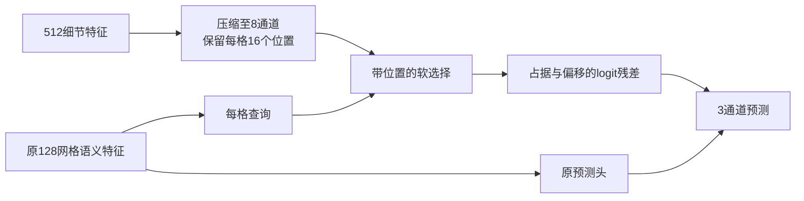

# Scope 10：高分辨率细节直达与位置选择（R1）

状态：待实现的首要结构假设；不是已证实的新方法。执行预算：R1与普通融合控制S1各1次seed42；入选后才追加种子。

## 问题与计算图

当前`UNetDeepBlink._forward_features`先恢复全分辨率，再经`encoders_v2`两次池化。首轮B/D/D2均在最终128网格特征或原图局部证据上做末端调整。R1改动信息进入预测的路径：让第二次编码前的细节直接参与，而非继续增加末端形态约束。它仍一格一位点，不解决多槽拥挤问题；当前验证集没有已记录的格内碰撞。

设第二次编码前特征`F0∈R^(B×96×512×512)`，原最终特征`F4∈R^(B×128×128×128)`。以下维度针对当前默认主干，实际实现需自动核验：

1. `T=Conv1x1(F0, 8)`；按`PixelUnshuffle(4)`等价的确定性重排得到每格16个8维位置特征`t_k`，保留`k=(i,j)`身份。**重排本身不做池化**，不宣称此前编码/投影没有信息损失。
2. `q=Linear(F4,8)`；`e_k=q·(W_k t_k+position_k)/sqrt(8)`，`π=softmax(e)`。键映射在16个位置共享权重，`position_k`为位置编码。值为`[W_v t_k, (i+0.5)/4, (j+0.5)/4]`，使选择后仍带格内位置信息。
3. `v=Σπ_k value_k`；`δ=MLP([F4,v])`输出3个logit残差，最后一层零初始化。`[p,dy,dx]=sigmoid(old_logit_conv(F4)+δ)`，输出布局和坐标含义不变。没有强制圆形峰、亮度阈值或“弱点必为背景”的规则。
4. 仍用原Dice+2RMSE、原网格标签及有效区域mask；无新增heatmap损失、形态真值或背景分割标签。mask只由图像几何生成。若边缘格非全有效，屏蔽无效位置并归一化；全无效格跳过，禁止softmax产生NaN。

第一版只用8维、单次交互，不搜索头数、温度或分支深度。参数增加目标≤5%，前向延迟目标≤原模型1.3倍，均为待测工程目标；超出时先检查实现，不悄悄换成另一架构。不能承诺零初始化后的模型训练必然保留原性能。

## 为什么值得先试，如何推翻

它同时改变了可用信息与使用方式；局部亮度统计并未作为置信度否决器。若弱点信息在第二次池化后受损，R1可能恢复有用证据；若信息原本已充分保留，收益可能为零。注意力也可能偏向亮背景，导致更多FP，或空间选择完全退化为常量。

**S1普通融合控制**使用相同`T`及16位置输入，按固定位置顺序拼接，经常规1×1投影得到10维细节向量，再与F4连接，使用同样残差输出。它保留细节和位置信息，但不做查询条件化软选择。匹配R1新增参数至±10%；若无法同时匹配参数/计算，登记差额，不能写“完全容量匹配”。两者使用相同主监督、优化、选模、校准和数据顺序。

另做不训练的权重行为检查：位置权重是否随图像变化、是否仅追随亮峰、去除位置身份是否改变预期样例。但只有R1与S1从头重训的比较能支持特殊交互的净收益；推理干预只是机制辅助。

成效检查：整体点F1、原定义弱点Recall、相近FP预算下弱点Recall、逐图漏检与误检、格内相位及1–3px平移敏感性；定位误差同时报告TP数量。S1同样改善而R1不占优时，应归因为细节旁路，不能归功于软选择。只改善定位而不提高检出F1，不满足本轮主要目标。

## 现有工作与可写主张

PixelUnshuffle为现成重排；高分辨率与跨层融合、注意力选择已有大量工作。SSHD-Net已经研究点监督的高分辨率交互；Spotiflow已有密集空间场。R1的待验证差异仅为：在DeepBlink二次池化前，把16相位的细节保留到由网格语义条件化的共同占据/定位路径，并在原监督下隔离其贡献。不是对全球新颖性的确认。若最近方法已包含同等机制，应降为任务适配方案或收缩主张，不靠更名解决。

实现边界：主干增加可选的特征返回接口，默认forward不变；新建独立`networks/detail_route.py`，接入现有注册、checkpoint及几何处理。定向检查重排索引、256/512、有效mask、零残差等价、偏移边界、梯度、CPU加载与XPU混合批次；不改原图、划分或现有权重。
