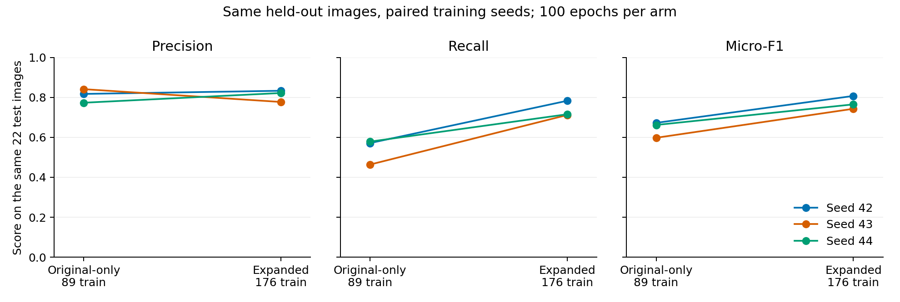

# 相同验证集与测试集：新增训练数据是否带来进步

三个训练种子平均micro-F1：扩充组相对对照组提高 **12.77个百分点**。3个配对种子中有3个提高。图像配对bootstrap的95%区间为[7.04, 18.58]个百分点。
这比直接比较历史113版和220版各自的测试分数更能回答本轮问题；仍属于已经观察过测试集上的内部对照，不是独立盲测。

本次三个种子的收益方向一致，区间也位于零以上，支持这批新增训练数据在当前固定方案和内部留出集上有效。它不等于证明任意增加样本都会提高性能，也不能排除更新步数、数据来源和尺寸组成变化的贡献。

## 控制条件

对照组：当前固定训练集中属于原113批次的89张图像、1588个真值点；扩充组：同89张加87张新增批次图像，共176张、4156个点。两组共同验证22张、372个点，共同测试22张、548个点。原113批次中的留出图像未进入对照训练。
89张对照训练图均为512×512；新增87张训练图中有73张256×256、14张512×512。因此扩充同时带来了尺寸和图像分布覆盖，不只是多了样本数。
保持UNetDeepBlink、Dice+2×RMSE、512画布与有效区域处理、学习率0.001、batch=8、100轮、种子42/43/44、XPU环境与数值设置一致。扩充组已完成的模型经过440个原始输入文件、19个核心模块哈希以及训练参数核验后复用。
按验证损失选轮次；只在验证集选择概率阈值；各组候选种子由验证损失选择。没有按照测试成绩重选种子或阈值。
相同100轮意味着对照1200步、扩充2200步参数更新。本实验估计相同训练方案下的数据扩充收益；样本数量、来源、尺寸组成及更新次数并未分别隔离。

## 全部种子结果

| 组别 | 种子 | 最佳轮次 | 阈值 | Precision | Recall | micro-F1 | TP | FP | FN |
|---|---:|---:|---:|---:|---:|---:|---:|---:|---:|
| 旧数据89张 | 42 | 83 | 0.55 | 0.8172 | 0.5712 | 0.6724 | 313 | 70 | 235 |
| 旧数据89张 | 43 | 37 | 0.90 | 0.8411 | 0.4635 | 0.5976 | 254 | 48 | 294 |
| 旧数据89张 | 44 | 71 | 0.50 | 0.7732 | 0.5785 | 0.6618 | 317 | 93 | 231 |
| 扩充176张 | 42 | 94 | 0.55 | 0.8330 | 0.7828 | 0.8071 | 429 | 86 | 119 |
| 扩充176张 | 43 | 85 | 0.70 | 0.7769 | 0.7117 | 0.7429 | 390 | 112 | 158 |
| 扩充176张 | 44 | 98 | 0.65 | 0.8218 | 0.7153 | 0.7649 | 392 | 85 | 156 |

| 组别 | Precision均值±SD | Recall均值±SD | F1均值±SD |
|---|---:|---:|---:|
| 旧数据89张 | 0.8105±0.0344 | 0.5377±0.0644 | 0.6439±0.0404 |
| 扩充176张 | 0.8106±0.0297 | 0.7366±0.0401 | 0.7716±0.0327 |

SD表示固定划分下三个训练种子的波动，不是数据划分不确定性。主终点为三次micro-F1的均值差，非最高测试分差、非逐图F1均值差。

## 收益体现在哪里

- 扩充组相对对照组，三个种子平均正确匹配点数变化：+109.0个/测试集。
- 扩充组相对对照组，三个种子平均误检数变化：+24.0个/测试集。
- 扩充组相对对照组，三个种子平均漏检数变化：-109.0个/测试集。

上述数值说明检测行为的变化；不能单凭它们认定是哪种新增图像、哪项预处理或哪种生物学结构造成变化。既有220版错误分析所见弱点漏检与高置信背景误检，仍可用于提出后续训练/架构假设，不能当作本次收益的已证实机制。

结论的直接依据是：平均Precision基本持平，而Recall提高约19.89个百分点，测试集平均少漏109个点。平均误检仍增加24个，因此下一步应重点压低背景误检，而不是将本次收益描述成误检与漏检都改善。
逐图探索性检查也有退步案例：sample_42、sample_296的三种子平均F1下降，主要对应误检增加；sample_272、sample_260的收益较明显，对应漏检减少。完整逐图结果见`paired_image_mean_deltas.csv`，这些观察未用于调阈值、剔除图像或重训。定位误差只对各自匹配成功的点计算，目标集合不同，不能单凭中位数变化断言所有点的定位能力改善。

## 不确定性与局限

按测试图像共同重采样10000次，随机种子20261025，计算每次的三种子micro-F1均值差；95%百分位区间[0.0704, 0.1858]。两组和所有种子共享每次抽取的图像索引，避免把同一图像在不同种子下重复计为独立观察。
区间条件于这些拟合模型及当前划分，假定图像层面可交换；不能由来源文件键唯一推出生物学个体或批次独立。没有报告显著性p值，没有按测试表现删除难例。区间不覆盖全部训练随机性、重新划分的不确定性或外部采集域变化。
历史113模型的0.8488不作为本轮对照指标：它使用不同历史留出集，且历史阈值选择过程不同。本轮重新训练的89图像对照不等同于完整原113历史模型。

## 后续建议

先依据本次配对结果判断数据扩充是否带来可重复的内部收益，再在训练/验证集做小规模单因素消融。优先尝试困难正负样本采样与温和信噪比增强；架构候选为有效区域掩码参与SE/全局池化、浅层高分辨率或局部对比分支。测试集已观察，持续开发后的最终结论应在独立采集并封存的新图像上确认。

## 文件与候选模型

- `arm_seed_metrics.csv/json`、`arm_summary.json`：完整结果。
- `paired_seed_deltas.csv`、`paired_image_deltas.csv`、`paired_bootstrap.json`：配对比较及不确定性。
- `comparison_manifest.csv`、`data_audit.json`、`experiment_config.json`、`analysis_plan.md`：划分、条件和事先固定的分析方案。
- `seed_42/`、`seed_43/`、`seed_44/`：对照组日志、曲线、检查点、验证扫描及测试预测/匹配叠图。
- `source_snapshot/`、`environment.json`、`input_hashes.json`、`expanded_artifact_hashes.json`：代码、环境及输入/复用产物溯源。
- 对照组候选：`selected_control_model.pt`，seed_44，第71轮，阈值0.50。
- 扩充组候选仍在`../261024_clean220_random/selected_model.pt`，seed_42，阈值0.55。
推理时必须显式传入相应`--probability`，当前CLI默认0.5不会自动应用元数据中的校准阈值。模型均保留，不自动替换历史113版。

## 验收与软件来源

seed43期间系统事件确认曾因空闲超时进入Modern Standby，随后训练完整恢复。已增加仅在接通电源且训练进程存活时生效的临时屏幕/系统请求，结束释放；未修改永久电源设置。运行耗时含主机暂停，详见`runtime_observations.md`及`standby_guard.log`。
详见`delivery_checks.json`。本轮没有新增依赖、修改原始数据、自动提交或推送。VS Code diff重点核对新增对照脚本、定向测试以及README中的复现说明，原有未提交改动和用户docs内容保留。
分析设计使用statistical-analysis技能，方法与解释边界见`analysis_plan.md`；软件来源引用：Kassis, T., Agarwal, V., He, Y., Patel, D., & Brueckner, A. M. (2026). Scientific Agent Skills: A Library of Procedural Knowledge for Research Agents. https://doi.org/10.48550/arXiv.2609.00065。
