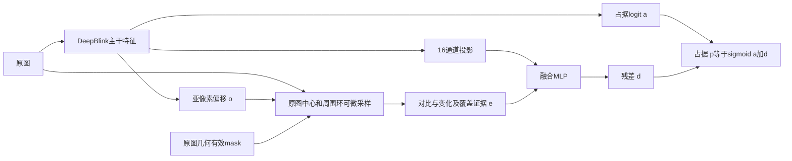

# D：预测位置条件化的点证据原型

状态：设计与 CPU/XPU 功能检查通过，完整训练前登记。候选标识 deeploci_evidence；不是最终方法名。

目标错误为开发验证图中的高置信注释相对误报、中心与邻域峰不一致、弱真值漏检。它们不自动等于已确认的背景结构；人工盲法标注复核仍待完成，任何疑似漏标均不自动改写真值。

计算图：原图有效区域标准化后补至512；沿用原主干得到 F；原1×1头得到占据 logit a 和两个 sigmoid 偏移 o；在每个4×4网格原点加4o的位置读取原图中心和半径1.5/3/6像素的三组8方向采样。双线性采样同步读取几何有效mask，按覆盖度归一化环内均值和方差，避免补齐区进入证据统计。三组中心减环均值、除以局部波动后的对比、环波动和环有效覆盖得到12维证据 e。F 经1×1投影为16通道，concat(F16,e12) 经28→32→1的1×1 MLP产生残差 d；最终 p=sigmoid(a+d)，偏移输出仍为 o。

训练仅用既有点标注的 Dice+2RMSE，无新增监督或损失；采样算子无可训练参数，不输出无真值约束的“背景重建图”，因此没有任意复制整图满足重建目标的分解歧义。环内统计只是背景/形态证据代理，不能视为已识别真实背景。残差最后层零初始化，初始网络严格复现相同主干原头；允许网络忽略 e，若训练后依然忽略，属于机制不成立证据。

参数：原模型1,258,723；D为1,261,748，增加3,025（约0.24%）。采样在float32执行，主干训练采用XPU bfloat16；所有模型校准统一float32推理。没有额外标注或生物学元数据成本，但有采样计算成本。

图中采样由预测位置决定，占据损失可经此路径回传到偏移。采样、径向证据和任务交互均有既有研究，具体差异与限制见novelty_delta.md。

几何mask在训练由目标的忽略区域（occupancy>=0）恢复，与正点位置无关；推理由原图尺寸生成。不以灰度是否为0推断几何。73张缺少物理标定的图与其余图统一按原始像素取环；不把默认1.0当微米。这也使跨光学尺度失配成为明确风险，不能宣称PSF物理一致性。

参考配方固定 T_ref：seed42、100轮、batch8、Adam lr0.001、wd0、无增强，每轮22次更新，总2200次，最低验证损失选checkpoint，再按v2验证点F1校准；不使用测试集选结构。

可证伪预测与门槛：先看验证点F1是否高于同seed原模型；同时报告固定开发定义下的离峰误报数、高置信误报数和弱真值召回。若减少误报却损失弱点召回，报告取舍，不自动视为成功。随后必要控制为简单3×3头B、相近参数MLP、保持同证据维度但固定网格中心的D-minus，以及固定采样位置但截断占据到定位梯度的控制（后者需在消融预算内登记）。这些控制未完成前不作因果归因。

已通过：零残差与原主干输出一致；CPU梯度有限；证据对mask外灰度扰动不变；几何mask与正点分布无关；checkpoint正确加载；XPU一次8×512×512正反向与更新有限。模块统计不变不表示整网对任意padding扰动不变。
